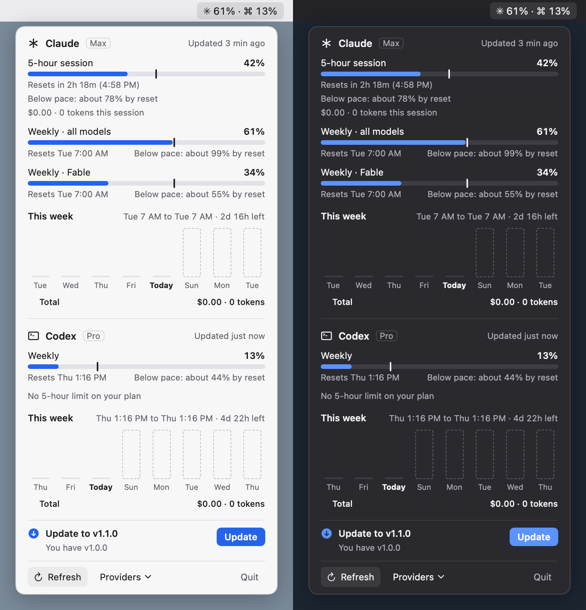
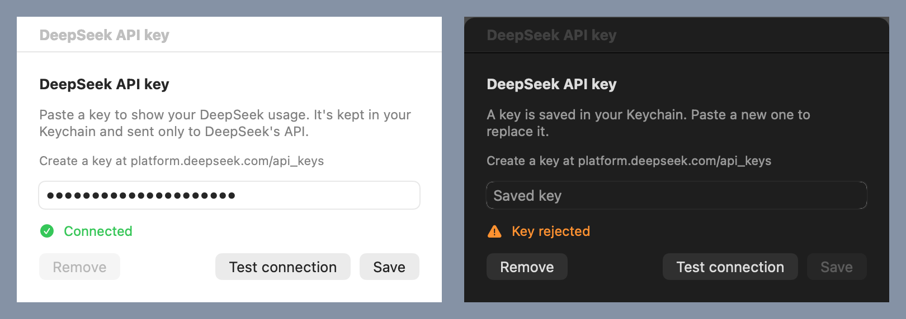

# UsageBar

A macOS menu bar app that shows how much of your AI subscription limits and API balances you've used.

- **Claude** and **Codex**: the 5-hour and weekly limit windows, with a pace prediction for each, plus a chart of this week's usage by model in API-equivalent dollars.
- **OpenRouter, DeepSeek, Moonshot (Kimi), z.ai (GLM Coding Plan) and GitHub Copilot**: credit limits, budgets, balances and quota windows, read with an API key you paste in.

The menu bar shows the windows you choose, e.g. `✳ 61% · ⌘ 13%`. The number turns orange at your warning threshold (90% unless you change it) and red at 100%, and a maxed window shows the time until it resets. macOS notifications tell you when a window crosses the threshold, when a window first seen at 100% has reached its limit, and when a maxed window resets. The **Alerts** section of the Providers menu sets the threshold (50, 75, 80, 85, 90 or 95%) and turns "Limit reached alerts" and "Limit reset alerts" on or off, and each provider's own **Alerts** switch silences it without hiding it. Each window alerts at most once per reset cycle, even if you change the threshold midway.

| Claude and Codex | Key providers |
|---|---|
|  |  |

The screenshots in this README are rendered from synthetic fixtures (`Fixtures/codex-cost.json`, `Fixtures/readme-key-providers.json`, `Fixtures/update-available.json` and `Fixtures/deepseek-balance.json`; see [Screenshots](#screenshots)), not from anyone's real account.

UsageBar is unofficial. It isn't affiliated with or endorsed by Anthropic, OpenAI, GitHub or any other provider it reads.

## Requirements

- macOS 26 or later.
- Swift 6.2 or later. The Command Line Tools are enough (`xcode-select --install`); full Xcode isn't needed.

## Using UsageBar

From install to uninstall, in the order you'll need it. [Troubleshooting](#troubleshooting) is at the end.

### 1. Install

UsageBar is built from source on the Mac that runs it. There's no signed download.

1. Install the Command Line Tools if you don't have them: `xcode-select --install`.
2. Clone the repo and build the app:

   ```sh
   git clone https://github.com/jhnqch/usagebar.git
   cd usagebar
   scripts/build.sh
   ```

   `scripts/build.sh` builds a release binary and packages an ad-hoc-signed app at `~/Applications/UsageBar.app`. To put it somewhere else, set `USAGEBAR_APP=/some/path/UsageBar.app`. The app isn't notarised, which is why you build it on the Mac that runs it.
3. Keep the clone where it is. The app records the clone's path and updates itself from it (step 8).

### 2. First launch

1. Open the app: `open ~/Applications/UsageBar.app`. It has no Dock icon and no window; it lives in the menu bar.
2. On its first run UsageBar adds itself to your login items, and macOS may notify you that a login item was added. To stop it starting at login, turn it off in **System Settings › General › Login Items & Extensions**. UsageBar won't add it back.
3. Look for its text in the menu bar, such as `✳ 61% · ⌘ 13%`. With nothing to show yet, it's a small gauge icon. Click it to open the popover.
4. Answer the macOS prompts when they come:
   - **Notifications.** UsageBar asks the first time it has an alert to show, not at launch. Click **Allow** to get limit alerts. If you decline, you can turn them on later in **System Settings › Notifications › UsageBar**.
   - **Keychain, for Claude.** If Claude is on, UsageBar reads Claude Code's saved login from the Keychain item `Claude Code-credentials` with the system's `security` tool. macOS may ask whether `security` may use that item. Enter your login password and click **Always Allow**. If you click **Deny**, Claude still works from the status line (step 6), without the weekly Fable window or the plan badge, and macOS asks again later, backing off from 10 minutes to once an hour.

### 3. Read the menu bar

1. Each provider in the menu bar has its symbol and the percent of its fullest limit window: `✳` is Claude, `⌘` is Codex, `ℤ` is z.ai, `⊛` OpenRouter, `⊚` GitHub Copilot.
2. The number turns orange at your warning threshold (90% unless you change it in step 7) and red at 100%.
3. While a window is at 100%, the number becomes the time until it resets, which is when you can work again.
4. "—" means UsageBar has no reading for that provider yet (see [Troubleshooting](#troubleshooting)).

### 4. Read the popover



1. **Section header.** Each provider has a section with its name, its plan badge (such as "Max" or "Pro") and when it was last updated ("Updated 3 min ago").
2. **Meters.** Each limit window has a meter with the percent used and when it resets ("Resets in 2h 18m (4:58 PM)", "Resets Tue 7:00 AM").
3. **Pace tick.** The small vertical tick on a meter marks how much of the window has passed. A bar that reaches past the tick is using the limit faster than an even pace would.
4. **Prediction.** The line under a meter says where you're headed at the pace so far:
   - "Below pace: about 78% by reset": at this rate you won't hit the limit.
   - "Ahead of pace: limit around 3:40 PM": at this rate you'll hit the limit before it resets.
   - "Limit reached": the window is full.

   There's no prediction in the first 10% of a window, when there's too little to go on.
5. **Balances and credits.** Key providers also show rows such as "$12.40 left of $20" (drawn as a meter) or "Balance ¥110 · ¥100 topped up · ¥10 granted".
6. **Cost chart.** "This week" charts Claude's and Codex's use for each day of the current weekly window, stacked by model, in API-equivalent dollars. Dashed outlines are days still to come. Hover over a bar for that day's total; "Total" sums the week. Claude's 5-hour meter also shows what the current session has cost.
7. **Notes.** A line such as "Key rejected" under a section explains a problem with that provider (see [Troubleshooting](#troubleshooting)).
8. **Footer.** **Refresh** (⌘R) reads the local sources and asks Codex again. Claude's usage endpoint and the key providers are asked again too, unless they were asked in the last minute or are backing off after an error. **Providers** opens the Providers menu (step 5). **Quit** (⌘Q) quits UsageBar.

### 5. Choose what's shown: the Providers menu

Click **Providers** in the popover's footer. It has a section for each provider:

1. **Show \<provider\>** turns the provider on or off. A provider that's off isn't polled, and for Claude, the Keychain isn't read. The subtitle says why one can't be shown yet: "Not found on this Mac" or "No API key saved".
2. **Show in menu bar** puts the provider's part in the menu bar text, or takes it out. Claude and Codex start in the menu bar; key providers start out of it, unless neither Claude nor Codex is on. Only providers with limit windows (Claude, Codex, z.ai, BigModel, OpenRouter budgets and Copilot's quota meter) have something to show there.
3. **API key…** (key providers only) opens the provider's key window (step 6). Its subtitle says whether a key is saved.
4. **Alerts** turns that provider's alerts on or off without hiding it (step 7).
5. Options of a provider, such as GitHub Copilot's **Quota meter and plan**.

Below the providers come the **Alerts** section (step 7) and the **Updates** section (step 8).

### 6. Connect each provider

Claude and Codex are found automatically. Each key provider needs a key you paste in once.

**Claude**

1. Set up Claude Code as usual. UsageBar finds it through `~/.claude`, `$CLAUDE_CONFIG_DIR` or the `claude` binary, and reads the usage endpoint with Claude Code's saved login (step 2).
2. For live limits while you work, point Claude Code's status line at UsageBar's command:

   ```sh
   ~/Applications/UsageBar.app/Contents/Helpers/usagebar-statusline install ~/.claude/settings.json
   ```

   It backs `settings.json` up and sets its `statusLine`. If you already have a different status line, it leaves it alone and says so; add `--replace` to replace it. If you set `USAGEBAR_APP` in step 1, use that path instead. If you use `$CLAUDE_CONFIG_DIR`, pass `$CLAUDE_CONFIG_DIR/settings.json`.
3. Send Claude Code a message. Its status line shows something like `opus 5.5 · 5h 42% · wk 61%`, and UsageBar's Claude meters update.

See [Claude](#claude) for what each source provides.

**Codex**

1. Install Codex (or the ChatGPT app, which bundles it) and sign in to it as usual.
2. UsageBar finds it through `~/.codex`, `$CODEX_HOME` or the `codex` binary and starts showing its limits. Nothing else to set up. See [Codex](#codex).

**Key providers** (OpenRouter, DeepSeek, Moonshot, Moonshot China, z.ai, BigModel, GitHub Copilot)



1. Create a key on the provider's site:

   | Provider | Where to get a key |
   |---|---|
   | OpenRouter | [openrouter.ai/settings/keys](https://openrouter.ai/settings/keys) |
   | DeepSeek | [platform.deepseek.com/api_keys](https://platform.deepseek.com/api_keys) |
   | Moonshot | [platform.kimi.ai](https://platform.kimi.ai/console/api-keys) |
   | Moonshot China | [platform.kimi.com](https://platform.kimi.com/console/api-keys) |
   | z.ai | [z.ai](https://z.ai/manage-apikey/apikey-list) (a GLM Coding Plan key) |
   | BigModel | [bigmodel.cn](https://bigmodel.cn/usercenter/proj-mgmt/apikeys) (a GLM Coding Plan key) |
   | GitHub Copilot | A [fine-grained personal access token](https://github.com/settings/personal-access-tokens) with the **Plan** user permission (read); add **Copilot Requests** (read) for the quota meter |

2. Open the popover, click **Providers**, and choose **API key…** under the provider.
3. Paste the key and click **Test connection**. "Connected" means the key works.
4. Click **Save**. The key goes into your Keychain, and the provider's section appears in the popover.

To replace a key, paste a new one in the same window. To remove it, click **Remove**. Each provider's section below says what it shows.

### 7. Set up alerts

UsageBar posts a macOS notification when a limit window crosses your warning threshold and when a full window resets. A window that's already at 100% when UsageBar first sees it in a cycle (say, it filled up while your Mac was asleep) gets a "limit reached" alert instead of the warning. Each window warns at most once per reset cycle, so one that got the threshold warning doesn't alert again when it reaches 100%.

1. Click **Providers** and find the **Alerts** section.
2. **Warn at** sets the threshold: 50, 75, 80, 85, 90 (the default) or 95% used. The menu bar and meters turn orange at the same threshold. If you lower it below a window's current use, that window warns once, unless it already warned this cycle.
3. **Limit reached alerts** and **Limit reset alerts** turn the "limit reached" and reset alerts on or off.
4. To silence one provider without hiding it, turn off its own **Alerts** item in its section.
5. Click a notification to open the popover.

### 8. Update

UsageBar records where it was built from: the clone's path, the GitHub repo `origin` points at (so a fork updates from the fork) and the version (`git describe --tags`). Once a day it asks GitHub for that repo's latest release.

**One click**

1. When a newer release is out, the popover shows **Update to vX.Y.Z** above the footer.
2. Click **Update**. UsageBar checks the release out in your clone (`git fetch --tags origin`, then `git checkout --detach vX.Y.Z`), builds it with `scripts/build.sh`, and relaunches into the new version. Your installed app is replaced only after the build succeeds.
3. If something fails, the popover says why and where the log is: `~/Library/Application Support/UsageBar/update.log`.

The update refuses to run when your clone has uncommitted changes, or is on a branch other than `main` and not on a release tag. It never deletes untracked files.

**Settings.** The **Updates** section of the Providers menu has "Check for updates automatically" (on by default), "Install updates automatically" (off by default) and "Check now".

**By hand.** If the clone has moved or the app wasn't built by `scripts/build.sh` from a clone, UsageBar only tells you about the new version and shows the commands to run. In your clone, with UsageBar's version in place of `vX.Y.Z`:

```sh
git fetch --tags origin
git checkout --detach vX.Y.Z
scripts/build.sh
```

Then quit UsageBar from its popover and open `~/Applications/UsageBar.app` again.

### 9. Uninstall

These steps remove everything UsageBar creates. Run the commands in Terminal.

1. **API keys.** For each key provider, open **Providers › API key…** and click **Remove**. (Or do it after quitting, in step 6 below.)
2. **Claude Code's status line.** Open `~/.claude/settings.json` (or `$CLAUDE_CONFIG_DIR/settings.json`) and delete the `"statusLine"` entry whose `command` ends in `usagebar-statusline`. The installer saved a copy of the file from before it changed it, `settings.json.usagebar-backup-<date>-<time>`, in the same folder; it holds your earlier status line, if you had one. Delete these backups once you no longer need them.
3. **Quit UsageBar:** click **Quit** in the popover.
4. **The login item:** in **System Settings › General › Login Items & Extensions**, select UsageBar under **Open at Login** and click **–**.
5. **The app:**

   ```sh
   rm -rf ~/Applications/UsageBar.app ~/Applications/UsageBar.app.new ~/Applications/UsageBar.app.previous
   ```

   (The `.new` and `.previous` copies exist only if an update was interrupted while swapping the app. If you set `USAGEBAR_APP`, use that path.)
6. **Keychain items** left over from step 1. Each saved key is a generic password with the service `io.github.jhnqch.usagebar.api-key`, one per provider. This deletes them all (macOS may ask for your password):

   ```sh
   while security delete-generic-password -s io.github.jhnqch.usagebar.api-key >/dev/null 2>&1; do :; done
   ```

   You can also search for `io.github.jhnqch.usagebar.api-key` in Keychain Access. Leave `Claude Code-credentials` alone: it's Claude Code's login, not UsageBar's.
7. **Settings** (providers, alerts, updates):

   ```sh
   defaults delete io.github.jhnqch.usagebar
   ```

8. **The support directory**, which holds the status line's saved limits (`claude-status-line.json`), the alerts already sent (`alerts.json`), the last update's log (`update.log`) and its build (`Update/`):

   ```sh
   rm -rf ~/Library/Application\ Support/UsageBar
   ```

9. **The clone.** Delete the `usagebar` folder you cloned in step 1. It also holds the build products in `.build`.

UsageBar keeps nothing else: no caches, cookies or other files. macOS may keep listing UsageBar under **System Settings › Notifications** for a while after it's gone.

### Troubleshooting

**A row or the menu bar shows "—".** UsageBar has no reading for it yet, or couldn't read the answer.

1. Click **Refresh** in the popover. Claude's usage endpoint or a key provider asked in the last minute, or backing off after an error, waits for its next turn.
2. For Claude: make sure the status line is installed (step 6) and send Claude Code a message, and allow the Keychain prompt (step 2). The weekly Fable window comes only from the usage endpoint, so it stays "—" if the Keychain read was denied.
3. For Codex: open Codex once to check it's installed and signed in. To pick a specific `codex` binary, set `USAGEBAR_CODEX` to its path.
4. For a key provider, read the note under its section (below).
5. If a provider changes an undocumented response, only the affected rows show "—"; please [open an issue](https://github.com/jhnqch/usagebar/issues).

**"Key rejected".** The provider answered 401 or 403, so the key is wrong, revoked or missing a permission.

1. Open **Providers › API key…** for that provider.
2. Paste a new key (for GitHub Copilot, check the token's permissions in step 6) and click **Test connection**.
3. Click **Save** once it says "Connected".

Other notes: "No API key saved" means there's no key to send (step 6). "api.deepseek.com answered HTTP 503" or "Couldn't read the answer from api.deepseek.com" (with that provider's host) means the provider had a problem; UsageBar tries again at the next poll, backing off from 10 minutes up to an hour while the provider is busy or down.

**Keychain prompts after rebuilding.** The app is signed ad hoc, so every build (including each update) is a new app to macOS. The first time a rebuilt UsageBar reads a saved API key, macOS asks whether UsageBar may use `io.github.jhnqch.usagebar.api-key`. Enter your login password and click **Always Allow**. The Claude prompt in step 2 can also come back after Claude Code refreshes its login.

**Claude's status line stopped updating.** The status line runs the command at the path you installed. If you moved the app or built it elsewhere, run the install command from step 6 again with the new path (add `--replace`).

**An update failed.** Read `~/Library/Application Support/UsageBar/update.log`. The usual causes are uncommitted changes in your clone or a build error. Fix the cause and click **Update** again, or update by hand (step 8).

**UsageBar isn't in the menu bar.** Check it's running: `pgrep -x UsageBar`. If it is, the menu bar may be too full; on a Mac with a notch, items past it are hidden. Quit some other menu bar apps, or turn off **Show in menu bar** for providers you don't need.

**See what UsageBar is doing.** Its log never contains keys or tokens:

```sh
log stream --predicate 'subsystem == "io.github.jhnqch.usagebar"' --level info
```

## Providers

What each provider connects with and shows. To turn providers on and off, put them in the menu bar and add keys, see [Using UsageBar](#5-choose-whats-shown-the-providers-menu).

Polling: key providers and Claude's usage endpoint are asked every 5 minutes and when you open the popover, at most once a minute each. Errors back off from 10 minutes up to an hour.

| Provider | Connects with | Shows | API |
|---|---|---|---|
| Claude | Claude Code's existing login, plus the status line command | 5-hour, weekly and weekly Fable windows; this week's cost by model | Status line: documented. Usage endpoint: **undocumented** |
| Codex | Codex's existing login, through `codex app-server` | Weekly window (and a 5-hour window if your plan has one); this week's cost by model | app-server: **experimental** |
| OpenRouter | API key | Key credit limit, guardrail and workspace budgets as windows, spend today, this week and this month | Documented |
| DeepSeek | API key | Balance per currency, topped up and granted | Documented |
| Moonshot / Moonshot China | API key (separate keys for platform.kimi.ai and platform.kimi.com) | Balance, voucher and cash | Documented |
| z.ai / BigModel | GLM Coding Plan API key (separate keys for z.ai and open.bigmodel.cn) | 5-hour and weekly prompt windows, the monthly MCP tools quota, the plan | **Undocumented** |
| GitHub Copilot | Fine-grained personal access token | AI credits (or premium requests on legacy plans) used this month by model; optionally a quota meter and plan | Billing: documented. Quota meter: **undocumented**, opt-in |

### Claude

UsageBar shows Claude once Claude Code is set up (`~/.claude`, `$CLAUDE_CONFIG_DIR`, or a `claude` binary in a usual install location). It has two sources for the limits:

1. **The status line** (live while you use Claude Code). Claude Code passes its official `rate_limits` to a status line command after each reply. UsageBar ships one inside the app; point Claude Code at it:

   ```sh
   ~/Applications/UsageBar.app/Contents/Helpers/usagebar-statusline install ~/.claude/settings.json
   ```

   This backs up `settings.json` and sets its `statusLine`. If you already have a different status line, it changes nothing and tells you; add `--replace` to replace it. The command saves the limits to `~/Library/Application Support/UsageBar/claude-status-line.json` and prints a compact line for the terminal, such as `opus 5.5 · 5h 42% · wk 61%`.

2. **Claude's OAuth usage endpoint** (undocumented): `GET https://api.anthropic.com/api/oauth/usage`, read with Claude Code's saved login from the Keychain item `Claude Code-credentials`. It's the only source for the weekly Fable limit, and it includes use from the Claude desktop app and claude.ai. UsageBar reads it with the system's `security` tool, so macOS may ask whether `security` may use that item, and may ask again after Claude Code refreshes its login. The plan badge (e.g. "Max") comes from the same saved login.

   When both sources describe the same window, the higher percent wins.

The cost chart reads Claude Code's transcripts in `~/.claude/projects` and prices each reply at API rates. It's a proxy: Anthropic doesn't publish how subscription limits are counted.

### Codex

UsageBar shows Codex once `~/.codex` (or `$CODEX_HOME`) exists or a `codex` binary is installed, including the one bundled in the ChatGPT app. It runs `codex app-server` and asks it for the rate limits, which it then pushes live. If app-server isn't available, the latest limits from Codex's session logs in `~/.codex/sessions` stand in. Set `USAGEBAR_CODEX` to the path of a `codex` binary to choose which one is used.

The cost chart reads the same session logs and prices them at OpenAI's API rates.

### OpenRouter

Create a key at [openrouter.ai/settings/keys](https://openrouter.ai/settings/keys). UsageBar reads [`GET /api/v1/key`](https://openrouter.ai/docs/api-reference/limits): the key's own credit limit as a meter, each guardrail or workspace budget as a window with pace and alerts, and spend for the current UTC day, week and month. Free-tier keys show a "Free" badge and the free-model requests left today.

### DeepSeek

Create a key at [platform.deepseek.com/api_keys](https://platform.deepseek.com/api_keys). UsageBar reads [`GET /user/balance`](https://api-docs.deepseek.com/api/get-user-balance): one balance row per currency, with what was topped up and what was granted. A balance that can no longer pay for calls says "Balance too low".

### Moonshot (Kimi API)

Moonshot runs two platforms whose keys don't work on each other's host, so each is its own provider:

- **Moonshot**: a key from [platform.kimi.ai](https://platform.kimi.ai/console/api-keys), read from `api.moonshot.ai`, in dollars.
- **Moonshot China**: a key from [platform.kimi.com](https://platform.kimi.com/console/api-keys), read from `api.moonshot.cn`, in yuan.

UsageBar reads [`GET /v1/users/me/balance`](https://platform.kimi.ai/docs/api/balance): the available balance, with the voucher and cash balances.

### z.ai (GLM Coding Plan)

For a GLM Coding Plan, use a key from [z.ai](https://z.ai/manage-apikey/apikey-list) (provider **z.ai**) or, on the China platform, from [bigmodel.cn](https://bigmodel.cn/usercenter/proj-mgmt/apikeys) (provider **BigModel**). UsageBar reads the undocumented `GET /api/monitor/usage/quota/limit` that z.ai's own tools use: the 5-hour and weekly prompt windows, with pace and alerts, the monthly MCP tools quota, and the plan name. An account without a Coding Plan says so.

### GitHub Copilot

Create a [fine-grained personal access token](https://github.com/settings/personal-access-tokens) with the **Plan** user permission (read). UsageBar reads GitHub's documented [billing usage reports](https://docs.github.com/en/rest/billing/usage) for the current UTC month: AI credits used by model (and, for annual Pro and Pro+ plans still on the old billing, premium requests). The reports cover only Copilot you pay for yourself; a seat from an organization or enterprise is reported to that organization, and UsageBar says so.

The **Quota meter and plan** option in the Providers menu (off by default) also reads GitHub's undocumented `GET /copilot_internal/user`, which Copilot's own clients use. It adds a quota meter (where your plan has a limit) and the plan badge. It needs the token's **Copilot Requests** permission (read) as well.

## Privacy and credentials

UsageBar runs entirely on your Mac. It has no server, analytics or telemetry, and talks only to the providers you turn on, plus GitHub for updates.

- **Claude Code's login is read-only.** UsageBar reads the access token from Claude Code's Keychain item, keeps it in memory, and sends it only in the `Authorization` header of requests to `api.anthropic.com`. It never writes, logs, forwards or refreshes it. Refresh tokens are single-use, so refreshing one would sign you out of Claude Code; UsageBar leaves that to Claude Code.
- **Codex's login stays inside Codex.** UsageBar runs your installed `codex app-server`, which uses its own login. UsageBar never reads Codex's credentials.
- **API keys** are stored in UsageBar's own Keychain items (service `io.github.jhnqch.usagebar.api-key`, one per provider). A key is sent only over https, only in the `Authorization` header, and only to its provider's host; any other host or a redirect is refused. Keys are never logged, written to disk or put in settings.
- **Settings** (which providers are on and in the menu bar, the Alerts and Updates settings, and when updates were last checked) live in `UserDefaults` under the bundle id `io.github.jhnqch.usagebar`. The support directory `~/Library/Application Support/UsageBar` holds the status line's saved limits, which alerts have already fired, and the last update's log and build.
- **Update checks** are a plain `GET https://api.github.com/repos/<owner>/<name>/releases/latest` with no token, at most once a day (and on "Check now"). Updating runs `git fetch` and `git checkout` in your checkout, with your own git setup, and `scripts/build.sh`.
- **Local logs** (Claude Code transcripts and Codex session logs) are only read, to draw the cost charts.

## Known risks

- **Undocumented endpoints can change or break without notice.** Claude's OAuth usage endpoint, z.ai's quota endpoint and GitHub's `copilot_internal/user` are undocumented, and `codex app-server` is marked experimental. When a response changes, only the affected rows show "—"; the rest of the popover keeps working.
- **Reading Claude Code's login** is a grey area in Anthropic's terms. UsageBar keeps it read-only and local, and never stores or forwards it. Turn Claude off in the Providers menu to stop reading it.
- **Some providers are built from their documentation only.** The OpenRouter, DeepSeek, Moonshot, z.ai and GitHub Copilot integrations were written against documented or published response shapes and tested with synthetic responses (and, for DeepSeek, Moonshot and z.ai, the real answer to an invalid key), not yet with real paid accounts. Please open an issue if one shows something wrong.
- **Dollar figures for Claude and Codex are API-equivalent estimates**, not what you pay for a subscription.
- **Status line data only updates while Claude Code is in use.** The usage endpoint fills the gaps every 5 minutes.

## Screenshots

The app can render its popover from a fixture without touching any real account:

```sh
~/Applications/UsageBar.app/Contents/MacOS/UsageBar --snapshot Fixtures/codex-cost.json out.png
```

It draws the popover in light and dark mode side by side, writes the key window beside it (`out-key.png`) and prints the Providers menu. Fixtures are JSON files of recorded or synthetic readings plus a fixed clock; see [CONTRIBUTING.md](CONTRIBUTING.md).

## Contributing

To run the tests:

```sh
scripts/test.sh
```

Use the script rather than plain `swift test`: with only the Command Line Tools installed, Swift Testing needs extra framework and rpath flags, which the script adds. With full Xcode the script runs plain `swift test`.

See [CONTRIBUTING.md](CONTRIBUTING.md) for building, testing and adding a provider.

## Licence

[MIT](LICENSE)
