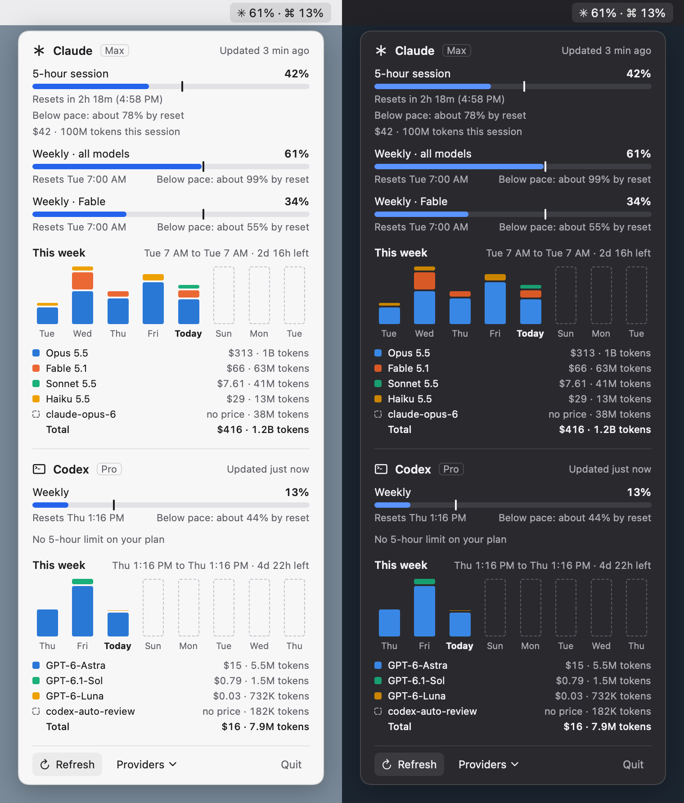
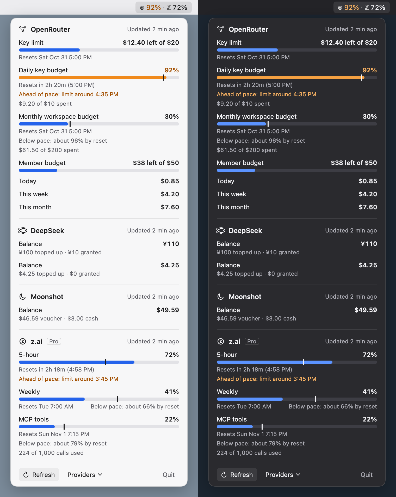

# UsageBar

A macOS menu bar app that shows how much of your AI subscription limits and API balances you've used.

- **Claude** and **Codex**: the 5-hour and weekly limit windows, with a pace prediction for each, plus a chart of this week's usage by model in API-equivalent dollars.
- **OpenRouter, DeepSeek, Moonshot (Kimi), z.ai (GLM Coding Plan) and GitHub Copilot**: credit limits, budgets, balances and quota windows, read with an API key you paste in.

The menu bar shows the windows you choose, e.g. `✳ 61% · ⌘ 13%`. The number turns orange from 90% and red at 100%, and a maxed window shows the time until it resets. macOS notifications tell you when a window crosses 90% and when a maxed window resets.

| Claude and Codex | Key providers |
|---|---|
|  |  |

The screenshots are rendered from the synthetic fixtures `Fixtures/codex-cost.json` and `Fixtures/readme-key-providers.json` (see [Screenshots](#screenshots)), not from anyone's real account.

UsageBar is unofficial. It isn't affiliated with or endorsed by Anthropic, OpenAI, GitHub or any other provider it reads.

## Requirements

- macOS 26 or later.
- Swift 6.2 or later. The Command Line Tools are enough (`xcode-select --install`); full Xcode isn't needed.

## Install

```sh
git clone <this repo> usagebar
cd usagebar
scripts/build.sh
open ~/Applications/UsageBar.app
```

`scripts/build.sh` builds a release binary and packages an ad-hoc-signed app at `~/Applications/UsageBar.app` (set `USAGEBAR_APP=/some/path/UsageBar.app` to put it elsewhere). The app isn't notarised, so it's meant to be built on the Mac that runs it. It has no Dock icon and starts at login.

To run the tests:

```sh
scripts/test.sh
```

Use the script rather than plain `swift test`: with only the Command Line Tools installed, Swift Testing needs extra framework and rpath flags, which the script adds. With full Xcode the script runs plain `swift test`.

## Providers

Open the popover and use **Providers** in its footer to turn providers on and off, choose which ones appear in the menu bar, and add API keys. Claude and Codex are found automatically; key providers appear once you save a key. **Test connection** in the key window checks a key before you rely on it.

Polling: key providers and Claude's usage endpoint are asked every 5 minutes and when you open the popover, at most once a minute each. Errors back off from 10 minutes up to an hour.

| Provider | Connects with | Shows | API |
|---|---|---|---|
| Claude | Claude Code's existing login, plus the status line command | 5-hour, weekly and weekly Fable windows; this week's cost by model | Status line: documented. Usage endpoint: **undocumented** |
| Codex | Codex's existing login, through `codex app-server` | Weekly window (and a 5-hour window if your plan has one); this week's cost by model | app-server: **experimental** |
| OpenRouter | API key | Key credit limit, guardrail and workspace budgets as windows, spend today, this week and this month | Documented |
| DeepSeek | API key | Balance per currency, topped up and granted | Documented |
| Moonshot / Moonshot China | API key (separate keys for platform.kimi.ai and platform.kimi.com) | Balance, voucher and cash | Documented |
| z.ai / BigModel | GLM Coding Plan API key (separate keys for z.ai and open.bigmodel.cn) | 5-hour and weekly prompt windows, the monthly MCP tools quota, the plan | **Undocumented** |
| GitHub Copilot | Fine-grained personal access token | AI credits (or premium requests on legacy plans) used this month by model; optionally a quota meter and plan | Billing: documented. Quota meter: **undocumented**, opt-in |

### Claude

UsageBar shows Claude once Claude Code is set up (`~/.claude`, `$CLAUDE_CONFIG_DIR`, or a `claude` binary in a usual install location). It has two sources for the limits:

1. **The status line** (live while you use Claude Code). Claude Code passes its official `rate_limits` to a status line command after each reply. UsageBar ships one inside the app; point Claude Code at it:

   ```sh
   ~/Applications/UsageBar.app/Contents/Helpers/usagebar-statusline install ~/.claude/settings.json
   ```

   This backs up `settings.json` and sets its `statusLine`. If you already have a different status line, it changes nothing and tells you; add `--replace` to replace it. The command saves the limits to `~/Library/Application Support/UsageBar/claude-status-line.json` and prints a compact line for the terminal, such as `opus 5.5 · 5h 42% · wk 61%`.

2. **Claude's OAuth usage endpoint** (undocumented): `GET https://api.anthropic.com/api/oauth/usage`, read with Claude Code's saved login from the Keychain item `Claude Code-credentials`. It's the only source for the weekly Fable limit, and it includes use from the Claude desktop app and claude.ai. macOS asks once whether UsageBar may read that Keychain item, and may ask again after Claude Code refreshes its login. The plan badge (e.g. "Max") comes from the same saved login.

   When both sources describe the same window, the higher percent wins.

The cost chart reads Claude Code's transcripts in `~/.claude/projects` and prices each reply at API rates. It's a proxy: Anthropic doesn't publish how subscription limits are counted.

### Codex

UsageBar shows Codex once `~/.codex` (or `$CODEX_HOME`) exists or a `codex` binary is installed, including the one bundled in the ChatGPT app. It runs `codex app-server` and asks it for the rate limits, which it then pushes live. If app-server isn't available, the latest limits from Codex's session logs in `~/.codex/sessions` stand in. Set `USAGEBAR_CODEX` to the path of a `codex` binary to choose which one is used.

The cost chart reads the same session logs and prices them at OpenAI's API rates.

### OpenRouter

Create a key at [openrouter.ai/settings/keys](https://openrouter.ai/settings/keys). UsageBar reads [`GET /api/v1/key`](https://openrouter.ai/docs/api-reference/limits): the key's own credit limit as a meter, each guardrail or workspace budget as a window with pace and alerts, and spend for the current UTC day, week and month. Free-tier keys show a "Free" badge and the free-model requests left today.

### DeepSeek

Create a key at [platform.deepseek.com/api_keys](https://platform.deepseek.com/api_keys). UsageBar reads [`GET /user/balance`](https://api-docs.deepseek.com/api/get-user-balance): one balance row per currency, with what was topped up and what was granted. A balance that can no longer pay for calls says "Balance too low".

### Moonshot (Kimi API)

Moonshot runs two platforms whose keys don't work on each other's host, so each is its own provider:

- **Moonshot**: a key from [platform.kimi.ai](https://platform.kimi.ai/console/api-keys), read from `api.moonshot.ai`, in dollars.
- **Moonshot China**: a key from [platform.kimi.com](https://platform.kimi.com/console/api-keys), read from `api.moonshot.cn`, in yuan.

UsageBar reads [`GET /v1/users/me/balance`](https://platform.kimi.ai/docs/api/balance): the available balance, with the voucher and cash balances.

### z.ai (GLM Coding Plan)

For a GLM Coding Plan, use a key from [z.ai](https://z.ai/manage-apikey/apikey-list) (provider **z.ai**) or, on the China platform, from [bigmodel.cn](https://bigmodel.cn/usercenter/proj-mgmt/apikeys) (provider **BigModel**). UsageBar reads the undocumented `GET /api/monitor/usage/quota/limit` that z.ai's own tools use: the 5-hour and weekly prompt windows, with pace and alerts, the monthly MCP tools quota, and the plan name. An account without a Coding Plan says so.

### GitHub Copilot

Create a [fine-grained personal access token](https://github.com/settings/personal-access-tokens) with the **Plan** user permission (read). UsageBar reads GitHub's documented [billing usage reports](https://docs.github.com/en/rest/billing/usage) for the current UTC month: AI credits used by model (and, for annual Pro and Pro+ plans still on the old billing, premium requests). The reports cover only Copilot you pay for yourself; a seat from an organization or enterprise is reported to that organization, and UsageBar says so.

The **Quota meter and plan** option in the Providers menu (off by default) also reads GitHub's undocumented `GET /copilot_internal/user`, which Copilot's own clients use. It adds a quota meter (where your plan has a limit) and the plan badge. It needs the token's **Copilot Requests** permission (read) as well.

## Privacy and credentials

UsageBar runs entirely on your Mac. It has no server, analytics or telemetry, and talks only to the providers you turn on.

- **Claude Code's login is read-only.** UsageBar reads the access token from Claude Code's Keychain item, keeps it in memory, and sends it only in the `Authorization` header of requests to `api.anthropic.com`. It never writes, logs, forwards or refreshes it. Refresh tokens are single-use, so refreshing one would sign you out of Claude Code; UsageBar leaves that to Claude Code.
- **Codex's login stays inside Codex.** UsageBar runs your installed `codex app-server`, which uses its own login. UsageBar never reads Codex's credentials.
- **API keys** are stored in UsageBar's own Keychain items (service `io.github.jhnqch.usagebar.api-key`, one per provider). A key is sent only over https, only in the `Authorization` header, and only to its provider's host; any other host or a redirect is refused. Keys are never logged, written to disk or put in settings.
- **Settings** (which providers are on and in the menu bar) live in `UserDefaults` under the bundle id `io.github.jhnqch.usagebar`. The support directory `~/Library/Application Support/UsageBar` holds the status line's saved limits and which alerts have already fired.
- **Local logs** (Claude Code transcripts and Codex session logs) are only read, to draw the cost charts.

## Known risks

- **Undocumented endpoints can change or break without notice.** Claude's OAuth usage endpoint, z.ai's quota endpoint and GitHub's `copilot_internal/user` are undocumented, and `codex app-server` is marked experimental. When a response changes, only the affected rows show "—"; the rest of the popover keeps working.
- **Reading Claude Code's login** is a grey area in Anthropic's terms. UsageBar keeps it read-only and local, and never stores or forwards it. Turn Claude off in the Providers menu to stop reading it.
- **Some providers are built from their documentation only.** The OpenRouter, DeepSeek, Moonshot, z.ai and GitHub Copilot integrations were written against documented or published response shapes and tested with synthetic responses (and, for DeepSeek, Moonshot and z.ai, the real answer to an invalid key), not yet with real paid accounts. Please open an issue if one shows something wrong.
- **Dollar figures for Claude and Codex are API-equivalent estimates**, not what you pay for a subscription.
- **Status line data only updates while Claude Code is in use.** The usage endpoint fills the gaps every 5 minutes.

## Screenshots

The app can render its popover from a fixture without touching any real account:

```sh
~/Applications/UsageBar.app/Contents/MacOS/UsageBar --snapshot Fixtures/codex-cost.json out.png
```

Fixtures are JSON files of recorded or synthetic readings plus a fixed clock; see [CONTRIBUTING.md](CONTRIBUTING.md).

## Contributing

See [CONTRIBUTING.md](CONTRIBUTING.md) for building, testing and adding a provider.

## Licence

[MIT](LICENSE)
